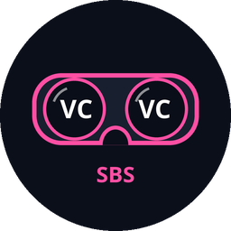
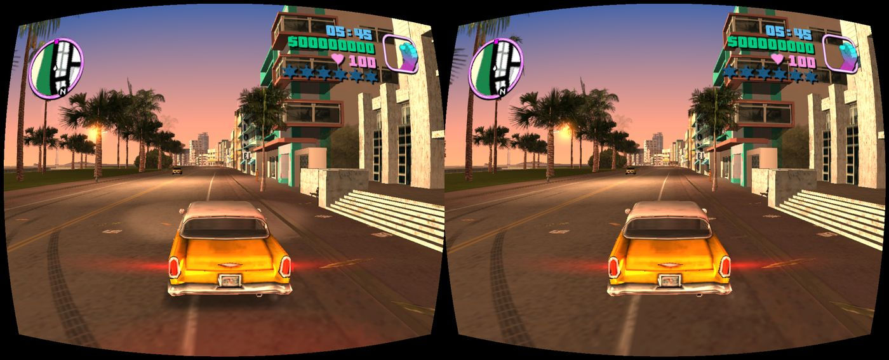
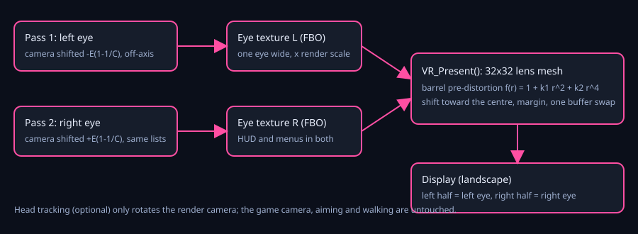
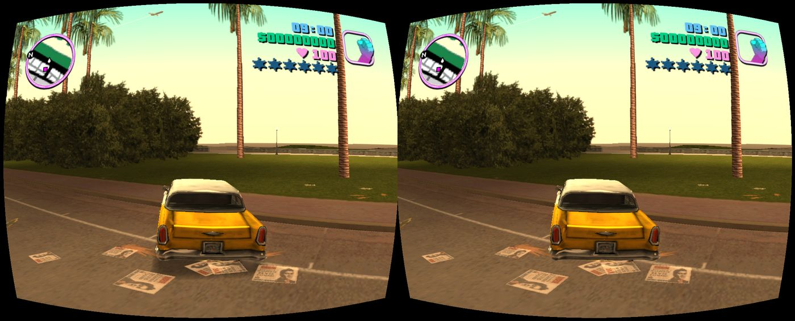
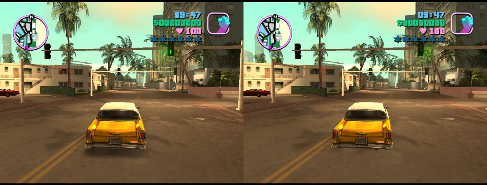
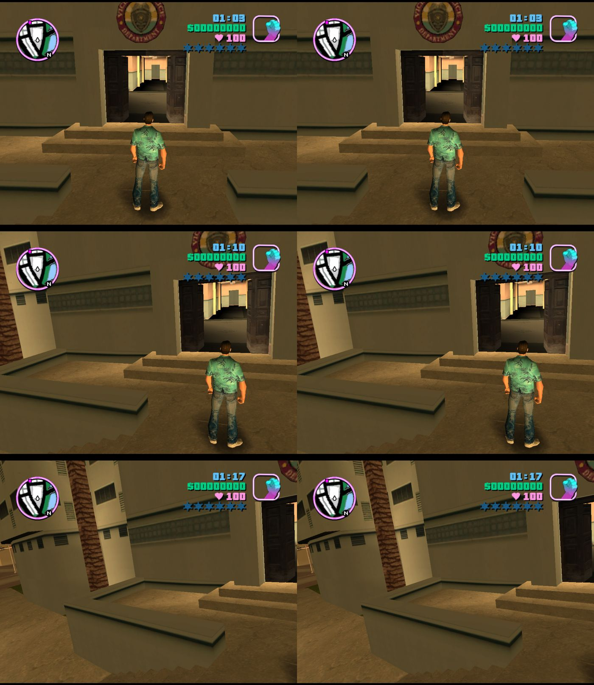

<p align="center"></p>

# reVCsbs: GTA Vice City in VR (side-by-side stereo) on Android

reVCsbs is a fork of the community Android port of **reVC** (the reverse-engineered GTA Vice City source) that adds a **stereo side-by-side (SBS) mode for Google Cardboard-style goggles**, lens distortion correction, image shift and margin for the lens spacing, Bluetooth gamepad support and optional head tracking from the phone gyroscope.

You need your own copy of GTA Vice City. Nothing from the original game is distributed here (see [Legal](#legal)).


*Game artwork belongs to Rockstar Games; it is shown only to illustrate the output of the VR code.*

## Features

- **Real stereo**: the world is rendered twice per frame (left and right eye) with an off-axis projection (never toe-in), one buffer swap per frame. `separation` (world metres) and `convergence` (distance of zero parallax) are configurable.
- **Cinema mode**: one render shown twice, for goggles where you only want the lens correction, or for comparing with stereo.
- **HUD, radar, text and menus have zero parallax**: the engine reports the width of **one eye** to the 2D code, so everything lays out for one eye and appears in the same place in both.
- **Lens pre-distortion** with a 32x32 mesh per eye, `f(r) = 1 + k1 r^2 + k2 r^4`, normalised at the nearest edge of the eye (not at the corners).
- **Shift** and **margin** for lenses whose spacing does not match the phone screen. All values are live.
- **Bluetooth gamepad** (SDL game controller) with the touch overlay hidden while a pad is active.
- **Head tracking** (optional, off by default): `TYPE_GAME_ROTATION_VECTOR` through JNI. It only rotates the render camera, so aiming and walking stay on the stick. Recenter with L3 + R3 or from the menu.
- **VR Settings menu** (Options -> VR Settings), operated with the pad: mode, separation, convergence, lens on/off, K1, K2, shift, margin, render scale, FOV scale, head tracking, roll scale, recenter. Every change is written to `vr.ini` and applied live.
- Everything is behind `#ifdef VR_SBS` and `VR_Enabled`. With VR off the game behaves like the base port.
- Keeps the screen on and requests Sustained Performance Mode where the phone supports it.



## Screenshots

All captured from the phone display (the two halves are what the goggles show), not through the lenses.


*Stereo SBS with lens correction.*


*Stereo SBS, street scene.*


*Stereo SBS: the traffic light is visible in both eyes.*


*Head tracking test captures (yaw 0, 20 and 40 degrees): only the render camera turns.*

## Status: what was and was not verified

Author's setup: Redmi Note 15 Pro+ (Android 15, 2772x1280, Adreno), GameSir BT pad, Cardboard-type goggles. Nothing was tested on other devices.

| Area | State |
|---|---|
| Build from a clean clone (Gradle, NDK 27) | works (`assembleDebug`) |
| Gamepad (menus, driving, shooting) | works on the author's phone |
| Cinema mode, eye difference with separation 0 | measured on the phone with screenshots: identical halves |
| Stereo | measured on the phone with screenshots: parallax appears, HUD identical in both eyes |
| Goggles | used by the author in Cardboard-type goggles (stereo depth with separation 0.25 and convergence 6 was "ok"; shadows were found to be left-eye only and fixed); other aspects not systematically evaluated |
| Head tracking | directions (left/right, up/down, tilt) confirmed by the author in goggles after flipping the yaw sign; drift over long sessions not measured |
| Lens K1/K2, shift, margin, FOV scale | starting values only, tuned by eye for one phone and one pair of goggles |
| Long sessions (20+ min), thermals | not measured |

Do not read these values as "good for your goggles". Tune them in the VR Settings menu or in `vr.ini`.

## Requirements

- An Android phone (arm64 or armv7, Android 7+), landscape, and a Cardboard-type headset. A Bluetooth gamepad is strongly recommended (touch does not work well inside goggles).
- Your own copy of GTA Vice City (PC version).
- To build: JDK 17, Android SDK (compileSdk 35), NDK `27.2.12479018`, CMake 3.22.1 (installed by the SDK manager), Git.

## Build

```bash
git clone --recursive git@github.com:<you>/reVCsbs.git
cd reVCsbs

# librw is a submodule; the VR work needs two patches applied to its working tree
cd vendor/librw
git apply ../../patches/librw-gl3-immediate-buffers.patch   # generic speed fix (single glBufferData per immediate draw)
git apply ../../patches/librw-vr.patch                      # VR only: camera textures in rasterRenderFast
cd ../..

echo "sdk.dir=$HOME/Android/Sdk" > android/launcher/local.properties
cd android/launcher
JAVA_HOME=/usr/lib/jvm/java-17-openjdk-amd64 sh gradlew assembleDebug
```

APK: `android/launcher/app/build/outputs/apk/debug/app-debug.apk`. Install with `adb install -r <apk>` (some phones, e.g. MIUI, ask for confirmation on the screen).

Notes:
- JDK 25 breaks the pinned Gradle 8.11, use JDK 17.
- The package name is `com.revc.game`; do not rename it (it would break updates over an existing install).
- `jniLibs.useLegacyPackaging = true` is set because of the 16 KB page size problem on Android 15+.

## Game data

Copy your own game files to the internal storage folder `/sdcard/reVC` (for example `adb push "<your game dir>" /sdcard/reVC`). The app asks for "All files access" on first start. Never commit or share those files.

## Configuration: `vr.ini`

`/sdcard/reVC/vr.ini`, `key = value`, polled twice a second, so you can edit it live (after `adb push` also run `adb shell touch /sdcard/reVC/vr.ini`). The in-game menu writes the same file. Without the file the code defaults are used.

| Key | Meaning | Code default |
|---|---|---|
| `VR_Enabled` | 0 / 1 | 0 |
| `VR_Mode` | `cinema` or `stereo` | stereo |
| `VR_Separation` | eye separation in world metres (0 .. 2) | 0.25 |
| `VR_Convergence` | metres to the zero-parallax plane (0.3 .. 100) | 6.0 |
| `VR_LensEnabled` | lens pre-distortion 0 / 1 | 1 |
| `VR_LensK1`, `VR_LensK2` | distortion coefficients | 0.20 / 0.19 |
| `VR_Shift` | move each eye image toward the screen centre, -0.3 .. 0.3 | 0.19 |
| `VR_Margin` | shrink each eye image, 0 .. 0.5 | 0.24 |
| `VR_EyeRenderScale` | resolution of the eye textures (0.25 .. 1.5) | 0.75 |
| `VR_EyeAspect` | aspect of the eye image, 0 = fill the half screen | 1.333 |
| `VR_HeadTracking` | 0 / 1 | 0 |
| `VR_FovScale` | multiplies the game FOV while VR is on | 1.5 |
| `VR_RollScale` | strength of head roll | 0.5 |
| `VR_Uncapped` | benchmark only: frame limiter and vsync off | not set |

If the image does not fuse, change **shift and margin first**, then separation. Typical sequence: cinema mode, fix shift/margin/lens, then switch to stereo.

## Controls

- Gamepad: standard Android layout through SDL. Menu: D-pad, A = accept, B = back.
- L3 + R3: recenter head tracking.
- Options -> VR Settings: D-pad left/right changes the highlighted value.
- Touch overlay: shown only while no pad is connected. With VR on, touch coordinates do not follow shift/margin/distortion, so touch is for debugging.

## How it works (short)

1. With VR on, `CameraSize` gives the camera a `CAMERATEXTURE` raster (an FBO) of **one eye**, so `RsGlobal.width/height` is one eye.
2. The render part of `Idle()` is `RenderFramePass(firstEye)`. Stereo runs it twice; the second pass reuses the render list and the per-frame lists built by the first (shadows, bright lights, shiny texts, glass, pickup messages, corona streak history), and uses the same random state so rain and sparks match.
3. `VR_Present()` draws the two textures through the lens mesh into the two halves of the window.
4. Head tracking builds a render-only camera basis; culling uses the same basis.

Code: `src/skel/vr/vr.{h,cpp}`, hooks in `src/rw/RwHelper.cpp`, `src/core/main.cpp`, `src/skel/sdl2/sdl2.cpp`, menu in `src/core/MenuScreensCustom.cpp`, Java side `HeadTracker.java` and `GameActivity.java`. Development log with measurements: [`NOTES.md`](NOTES.md) (Polish).

## Known issues

- The code defaults are the values tuned by the author on one phone and one pair of goggles; they are not general.
- Four more one-eye-only bugs found in the GTA III variant (bright lights = traffic lights, shiny texts = pedestrian signs, glass entities, pickup messages = weapon shop prices) have the same cause here. The same fix was applied to this repository, but it **was not checked on a phone or in goggles for Vice City**.
- Possible bright cracks along terrain borders (T-junctions in the original map geometry, also present with VR off) were seen in GTA III; not checked here.
- Motion blur and reflections: motion blur that needs the previous frame is off while the two stereo passes are drawn; reflections, near weapon / vehicle interiors were not examined one by one.
- Yaw drift of the game rotation vector (no magnetometer) is expected; use recenter (L3 + R3). Long-session drift and 20+ minute thermals are not measured. A 5 minute session showed no throttling (battery 37 C, FPS about 29.4 under the 30 FPS limiter).
- FPS: with the limiter off (`VR_Uncapped = 1`), stereo scale 0.75 reached 119 FPS on a quiet street after the librw immediate-mode fix; treat as best case. The game's own limiter is 30 FPS.

## Credits

- **reVC** by the GTAmodding team and [`mrxenginner/reVC`](https://github.com/mrxenginner/reVC) (branch `miami`).
- [`codepdbh/revc-android-port-evolved`](https://github.com/codepdbh/revc-android-port-evolved): the Android port this fork is based on (base commit `e1229d04`).
- [`aap/librw`](https://github.com/aap/librw) and [`mrxenginner/librw`](https://github.com/mrxenginner/librw). The generic immediate-mode fix was also proposed upstream: https://github.com/mrxenginner/librw/pull/1
- SDL2, OpenAL Soft, mpg123, opus/ogg.
- The VR work (stereo, lens mesh, head tracking, menu, pad fixes, icon) was developed with Claude Code and tested by the author.

The licence of this repository is in [`LICENSE.md`](LICENSE.md) (MIT with a proof-of-usage condition, inherited from upstream). Read it before reusing the code.

## Legal

- This is an unofficial fan project. It is not affiliated with, endorsed by or connected to Rockstar Games or Take-Two Interactive. "Grand Theft Auto" and related names belong to their owners.
- **No game assets are included in this repository, in its history, in the APK or in any release.** No models, textures, audio, scripts, text tables (`.gxt`), `.img` archives or other data from the original game. You must own a copy of the game and put its files on your device yourself.
- Files from the upstream forks that were derived from original game data (the `gamefiles/` directory, Windows icons, upstream screenshots) are left out of this repository on purpose. Do not add them back.
- The screenshots in `docs/images/` are captures of the phone display. Rockstar's artwork and logos visible in them belong to Rockstar Games and are shown only to illustrate the output of the VR code; they are not game files.
- Do not commit signing keys. The APKs built here are signed with the Android debug key only.

## For AI coding assistants

See [`CLAUDE.md`](CLAUDE.md).
